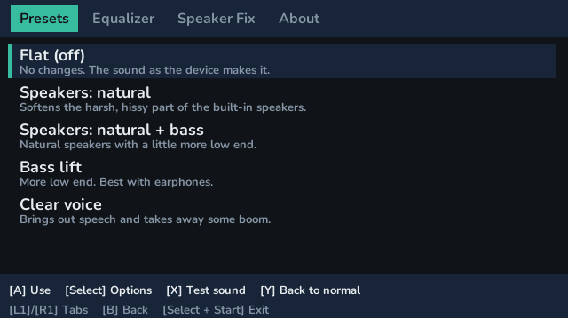
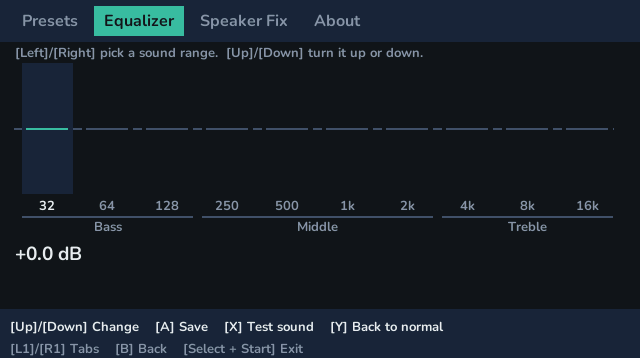

# FroggySoundTuner

A sound control panel for the **Datafrog SF3500** running TreeFrogUI: a DSP for the whole system, in the
way the control panel that comes with a sound card's driver is. The SF3500's sound chip has its own 10-band
equalizer; FroggySoundTuner sets it from a list of presets, lets you make and name your own, and has a tab
for the left/right problem of the built-in speakers. It runs from the Ports list and is translated through
TreeFrogUI's own language setting.

**It is a helper, not a requirement.** Nothing depends on it, and every game and emulator runs the same
without it. Emulator cores and ports decide what they send to the sound chip (volume, mono and so on);
FroggySoundTuner works one level below them, on the chip itself, so what you choose applies to everything
the device plays, without any program having to know about it, until the device is turned off.

 

## Using it

Unzip `FroggySoundTuner-1.0.zip` at the root of the SD card, then open **FroggySoundTuner** in the Ports list.

| Tab | What it does |
|--|--|
| **Presets** | Five ready-made sounds (Flat, Speakers: natural, Speakers: natural + bass, Bass lift, Clear voice) and the ones you made. **A** uses the highlighted one, **Select** opens Edit / Rename / Delete, **X** plays a test sweep. |
| **Equalizer** | Ten bars from bass to treble. Move them and the sound changes as you go; **A** saves what you made as a preset with a name you type. |
| **Speaker Fix** | The built-in speakers only play the right side of stereo sound. Choose Automatic, Always on or Off, and hear the difference with a left, right and both test. See below. |
| **About** | A short guide, in the language you use. |

**[Y]** goes back to the normal sound at any time, and **[B]** or **[Select + Start]** leaves. A preset
stays on while you play games and use other apps, and is switched off when the device is turned off, so
open FroggySoundTuner again after starting up. Your games and saves are never changed.

## What it is built on (measured, not assumed)

The sound chip's driver offers many controls. Measured with a line capture from the headphone jack, on
one SF3500, **only the volume and the 10-band equalizer do anything**: mute, left/right balance,
bass/treble and the equalizer presets are accepted and ignored. The equalizer keeps its setting after the
program that set it exits (that is how a preset can stay on during a game) and is cleared when the device
is powered off. One unit of band gain is about 0.1 dB. The built-in speakers play only the right channel
and have a 3 to 6 kHz peak of +11 to +14 dB, which the Speakers presets cut by about 8 dB. The presets
other than "Speakers: natural", which is the measured cut, are first drafts to be judged by ear.

## Speaker Fix

The setting is saved in a small file, `/mnt/sdcard/speaker_fix.txt`, containing `speaker_fix=auto`,
`speaker_fix=on` or `speaker_fix=off`. **At the moment no program reads it**: it is for programs that
choose to (a patch for picoarch is proposed to its author), and emulators have their own "Mono output"
option in their pause menu. The test on the tab does follow the setting, so you can hear what it would do.
In Automatic mode a program mixes left and right only while the speakers are in use; the jack's pin
(`/proc/device-tree/panel/speaker-output`, read-only) tells it.

## Languages

English, German, Spanish, French, Italian, Polish, Brazilian Portuguese, Russian, Turkish, Japanese and
Simplified Chinese, chosen by TreeFrogUI's `language=` setting (`/mnt/sdcard/frogui/settings.txt`). The
text uses TreeFrogUI's own fonts, with `TreeFrogUnicode.ttf` when a language needs it. **The translations
are drafts written with Claude and have not been reviewed by native speakers**; each file says so. A fix is
a change to a plain text file in `lang/`, with no rebuild: see [docs/TRANSLATING.md](docs/TRANSLATING.md).

## Files it writes

`profiles.txt` (your presets) and `state.txt` (which preset is on, valid until the next boot) in its own
folder, and `speaker_fix.txt` at the card root. Delete any of them to start over.

## Tested on

An SF3500 with TreeFrogUI v1.8.0_u. Other TreeFrogUI devices use the same sound driver family but this
has not been tried on them. The screen adapts to the panel's shape.

## Building

```sh
SF3500_TC=/path/to/toolchain/host ./build.sh      # froggysoundtuner.mipsel
./package.sh                                      # dist/FroggySoundTuner-1.0.zip
python3 tools/check_lang.py                       # checks every translation against English
```

The toolchain is a MIPS32r2 GCC (tested with Codescape MIPS MTI GCC 6.3.0) whose sysroot has FreeType 2.

## Licence

GPL 3 or later (see `LICENSE`). Where parts came from, and what is not included, is in `NOTICE.md`.

Written with the help of Claude Code.
